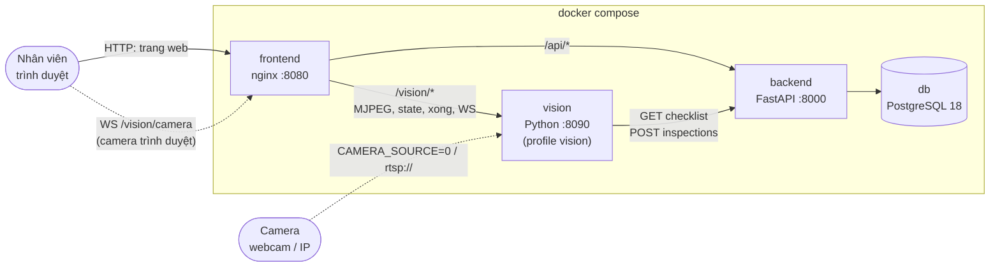
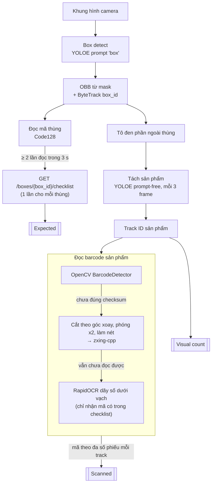
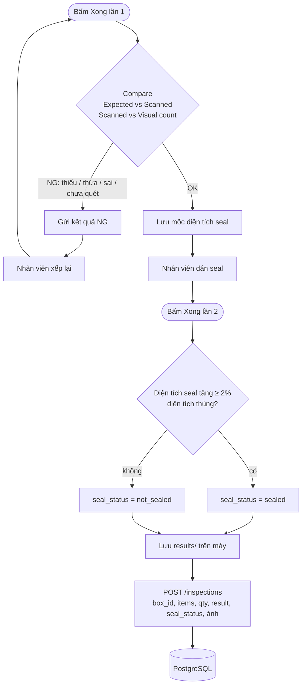

# barcode-cv

Hệ thống kiểm tra đóng gói bằng camera tại bàn đóng hàng, đặt trước bước dán seal.

Camera nhận diện **thùng hàng** và đọc **mã thùng**, rồi lấy checklist đơn hàng từ backend. Hệ thống tách từng **sản phẩm trong thùng**, đọc **barcode** của từng sản phẩm, và so sánh với checklist khi nhân viên bấm **Xong**. Nếu khớp (OK), hệ thống kiểm tra **seal**, rồi gửi kết quả về backend.

## Mục lục

- [Tính năng](#tính-năng)
- [Kiến trúc](#kiến-trúc)
- [Pipeline](#pipeline)
- [Yêu cầu](#yêu-cầu)
- [Bắt đầu nhanh](#bắt-đầu-nhanh)
- [Cấu hình](#cấu-hình)
- [Backend API](#backend-api)
- [Phát triển](#phát-triển)
- [Cấu trúc thư mục](#cấu-trúc-thư-mục)
- [Giới hạn đã biết](#giới-hạn-đã-biết)

## Tính năng

- Nhận diện thùng hàng zero-shot (YOLOE-26), không cần train, kèm tracking (ByteTrack).
- Đọc mã thùng Code128 trên nhãn vận đơn, rồi lấy checklist của thùng từ backend.
- Tách và theo dõi từng sản phẩm trong thùng, đếm số sản phẩm nhìn thấy (visual count).
- Đọc barcode EAN-13 theo ba tầng: OpenCV, rồi zxing-cpp, cuối cùng là OCR (RapidOCR). Chỉ nhận mã đúng checksum.
- So sánh ba nguồn khi bấm Xong: Expected (checklist), Scanned (mã đã quét) và Visual count (số sản phẩm nhìn thấy).
- Kiểm tra seal dựa vào phần diện tích băng keo hoặc tem seal tăng thêm.
- Web UI cho nhân viên: video trực tiếp, checklist cập nhật liên tục, dùng được webcam của trình duyệt.
- Kết quả luôn được lưu trên máy trước. Gửi lên backend không bị trùng bản ghi (theo `inspection_id`).

## Kiến trúc



| Service | Thư mục | Việc |
|---|---|---|
| **frontend** | `services/frontend` | Web UI nhân viên: video có khung thùng và mask sản phẩm, checklist cập nhật liên tục, cảnh báo, nút Xong. nginx vừa phục vụ trang vừa chuyển tiếp yêu cầu tới hai service còn lại. |
| **vision** | `services/vision` | Đọc camera, chạy YOLO, đọc barcode và OCR, so sánh, kiểm tra seal. Cung cấp `GET /stream.mjpg`, `GET /state`, `POST /xong`, `WS /camera`. |
| **backend** | `services/backend` | FastAPI + PostgreSQL: lưu checklist của từng thùng và kết quả kiểm tra (kèm ảnh). |
| **db** | image `postgres:18` | Dữ liệu nằm trong volume `pgdata`. |

## Pipeline

### Xử lý từng khung hình



### Luồng kiểm tra khi bấm Xong



| Bước | Cách làm |
|---|---|
| Thùng | YOLOE-26 zero-shot với prompt `"box"`. OBB là hình chữ nhật xoay nhỏ nhất bao quanh mask. Tracking dùng ByteTrack (`box_tracker.yaml`). Nếu detector bỏ lỡ một frame, thùng vẫn được giữ thêm 1 s. |
| Sản phẩm | YOLOE-26 prompt-free (khoảng 4.5k lớp), chạy trên cả khung hình với phần ngoài thùng đã tô đen. Bỏ các lớp chữ/nhãn và các mask to bằng cả thùng. Chạy mỗi 3 frame. Khi so sánh, chỉ tính sản phẩm còn thấy trong thùng trong 3 s gần nhất. |
| Barcode | Chỉ nhận **EAN-13 đúng checksum** (sản phẩm) và **Code128** (nhãn vận đơn của thùng). Mỗi track lấy mã có số lần đọc nhiều nhất qua các frame. OCR chỉ dùng cho sản phẩm, chạy nền, giới hạn 2 luồng CPU. |
| box_id | Mã thùng phải đọc được ít nhất 2 lần trong 3 s gần nhất. Mỗi lúc chỉ có một thùng trên bàn. Khi đã có box_id, chỉ mã nằm trên thùng đang thấy mới đổi được thùng. |
| Seal | YOLOE zero-shot (`"packing tape"`, `"seal sticker"`). Mốc diện tích seal được lấy lúc so sánh ra OK, vì thùng thường đã có sẵn băng keo. |

## Yêu cầu

- Docker và Docker Compose.
- [uv](https://docs.astral.sh/uv/) và Python 3.13, nếu chạy service trực tiếp trên máy.
- Webcam, camera IP, hoặc trình duyệt có camera.
- Khoảng 300 MB cho trọng số model, được tải tự động lần đầu.

## Bắt đầu nhanh

1. Tạo `.env` từ `.env.example` và đặt `POSTGRES_PASSWORD`:
   ```bash
   cp .env.example .env
   ```
2. Chọn một trong hai cách chạy vision.

   **a) Vision trong Docker, dùng camera của trình duyệt** (mặc định, chạy được cả trên Windows/macOS):
   ```bash
   # .env: VISION_URL=http://vision:8090, CAMERA_SOURCE_DOCKER=browser
   docker compose --profile vision up -d --build
   ```
   Trên trang web, bấm **Bật camera** rồi cho phép trình duyệt dùng camera. Trang sẽ gửi khoảng 10 frame/s cho vision qua WebSocket.

   **b) Vision chạy trực tiếp trên máy, tự đọc webcam:**
   ```bash
   # .env: VISION_URL=http://host.docker.internal:8090, CAMERA_SOURCE=0, BE_URL=http://localhost:8080/api
   docker compose up -d --build
   cd services/vision && uv sync && uv run python -m vision
   ```
3. Nạp checklist mẫu rồi tự kiểm tra backend:
   ```bash
   docker compose exec backend python -m app.server seed
   docker compose exec backend python -m app.server check
   ```
4. Mở **http://localhost:8080**. Bấm **Enter**, **Space** hoặc nút **XONG**:
   - Lần 1: so sánh với checklist. Nếu NG, xếp lại rồi bấm lại. Nếu OK, dán seal.
   - Lần 2: kiểm tra seal và gửi kết quả.

Lần chạy đầu, vision tải trọng số model (`yoloe-26s-seg.pt`, `yoloe-26s-seg-pf.pt`, `mobileclip2_b.ts`). Trong Docker, chúng được lưu vào volume `vision-data` nên chỉ tải một lần.

## Cấu hình

### docker compose (`.env`)

| Biến | Mặc định | Ý nghĩa |
|---|---|---|
| `POSTGRES_PASSWORD` | (bắt buộc) | Mật khẩu PostgreSQL trong Docker. |
| `FRONTEND_PORT` | `8080` | Cổng web UI. |
| `VISION_URL` | `http://host.docker.internal:8090` | Địa chỉ frontend dùng để gọi vision. Đặt `http://vision:8090` khi chạy vision trong Docker. |
| `CAMERA_SOURCE_DOCKER` | `browser` | Camera cho container vision: `browser`, URL `rtsp://…`, hoặc `0` (chỉ Linux, kèm bỏ comment `devices` trong `docker-compose.yml`). |

### vision

| Biến | Mặc định | Ý nghĩa |
|---|---|---|
| `CAMERA_SOURCE` | `0` | Số thứ tự webcam, URL luồng camera, hoặc `browser`. Mỗi lúc chỉ một tab được gửi hình, tab mở sau sẽ thay tab trước. Mất tín hiệu thì tự kết nối lại. |
| `BE_URL` | (trống) | URL backend. Để trống thì checklist lấy từ `MOCK_CHECKLIST` và kết quả chỉ lưu trên máy. |
| `VISION_PORT` | `8090` | Cổng HTTP của vision. |
| `RESULTS_DIR` | `results` | Nơi lưu bản sao mọi kết quả (`results.jsonl` + ảnh) trước khi gửi lên backend. |
| `MOCK_CHECKLIST` | `mock_checklist.json` | Checklist giả dùng khi chưa có backend. |

Khi gửi lên backend, lỗi mạng hoặc 5xx được thử lại 3 lần, còn 4xx thì không.

### backend

| Biến | Ý nghĩa |
|---|---|
| `DATABASE_URL` | Chuỗi kết nối PostgreSQL, ví dụ `postgresql://postgres:<password>@localhost:5432/barcode_cv`. docker compose tự đặt biến này. |

## Backend API

Khi gọi qua nginx, thêm tiền tố `/api`. Tài liệu API tương tác ở `http://localhost:8080/api/docs`.

| Endpoint | Mô tả |
|---|---|
| `GET /boxes/{box_id}/checklist` | Trả `[{"item_id": "...", "barcodes": ["893..."], "quantity": 1}]`. Trả 404 nếu thùng không có đơn. |
| `PUT /boxes/{box_id}/checklist` | Tạo mới hoặc thay toàn bộ checklist của thùng. Trả 422 nếu trùng `item_id` hoặc `quantity < 1`. |
| `POST /inspections` | Kết quả do vision gửi, kèm `image_jpeg_b64`. Gửi lại cùng `inspection_id` không tạo bản ghi mới. |
| `GET /inspections?box_id=&limit=` | Danh sách kết quả, mới nhất trước. |
| `GET /inspections/{id}/image` | Ảnh JPEG chụp lúc bấm Xong. |

Schema nằm ở `services/backend/app/schema.sql`. Các bảng được tạo tự động khi backend khởi động.

> **Chưa có xác thực.** Chỉ mở cổng 8080 trong mạng nội bộ.

## Phát triển

Mỗi service là một project uv riêng, có `pyproject.toml` và `uv.lock` riêng.

```bash
cd services/backend && uv sync && uv run uvicorn app.server:app --port 8001   # cần DATABASE_URL
cd services/vision  && uv sync && uv run python -m vision                      # cần CAMERA_SOURCE, BE_URL
```

Vision dùng **PyTorch bản CPU** để image Docker không kéo theo vài GB thư viện CUDA.

### Kiểm tra

Mỗi lệnh in ra `ok` nếu chạy đúng:

```bash
cd services/vision  && uv run python -m vision.inspection && uv run python -m vision.barcode_reader
cd services/backend && uv run python -m app.server check
```

### Train model OBB cho thùng (tuỳ chọn)

Detector zero-shot hiện bắt được thùng ở khoảng 74% frame. Để cải thiện:

```bash
cd services/vision
uv run python -m vision.train_obb collect   # SPACE: lưu frame khi khung xanh đúng, q: thoát
uv run python -m vision.train_obb train     # fine-tune yolo26n-obb.pt -> runs/obb/train/weights/best.pt
```

Nên thu khoảng 150–300 ảnh, đủ nhiều góc, khoảng cách và ánh sáng, có cả frame không có thùng.

### Các thử nghiệm chưa đưa vào

Thử trên 315 khung hình webcam đã ghi:

| Thử nghiệm | Kết quả | Lý do không dùng |
|---|---|---|
| YOLO tự train để dò barcode (`datasets/qr_codes`, test mAP50 0.823) | Tìm thấy barcode ở 284/315 frame (OpenCV: 205), nhưng chỉ đọc được 109/315 (OpenCV: 104) | Đọc ra 10 mã EAN-13 sai |
| YOLO tự train để dò thùng (`datasets/boxes`) | Bắt được 78/100 thùng | Báo nhầm thùng ở 166/180 cảnh trống |
| Super-resolution (FSRCNN/ESPCN) trước zxing | 78–107/315 frame | Không tốt hơn phóng to cubic x2 (109/315) |
| Tesseract thay RapidOCR | 0–1/109 barcode khó | RapidOCR đọc được 7/109 |

`datasets/` và `runs/` không được commit (`.gitignore`).

## Cấu trúc thư mục

```
docker-compose.yml, .env.example
services/
  frontend/  Dockerfile, default.conf.template (nginx), public/ (index.html, app.js, style.css)
  backend/   Dockerfile, pyproject.toml, uv.lock, app/ (server.py, schema.sql)
  vision/    Dockerfile, pyproject.toml, uv.lock, mock_checklist.json
    vision/
      __main__.py        HTTP API (FastAPI)
      pipeline.py        vòng lặp camera: thùng, sản phẩm, seal
      inspection.py      so sánh, gán mã cho track, box_id
      barcode_reader.py  OpenCV → zxing → RapidOCR
      be_client.py       lấy checklist, gửi kết quả
      box_tracker.yaml   cấu hình ByteTrack
      train_obb.py       thu ảnh và train OBB
```

## Giới hạn đã biết

- **Nhận diện thùng zero-shot còn yếu:** chỉ bắt được thùng ở khoảng 74% frame. Muốn ổn định cần train model OBB.
- **Seal:** chỉ dựa vào phần diện tích seal tăng thêm, chưa phân biệt seal còn nguyên hay bị rách, và chưa thử với seal thật.
- **Barcode trên webcam 1280×720:** mỗi vạch chỉ rộng khoảng 2 px. Frame bị nhòe do chuyển động sẽ không đọc được, nên cầm yên sản phẩm khoảng nửa giây. Điểm nghẽn là chất lượng ảnh, không phải khâu tìm barcode.
- **Đếm trùng:** nếu tracker đổi ID của cùng một sản phẩm, sản phẩm đó bị đếm 2 lần.
- **Camera trình duyệt cần trang an toàn:** trình duyệt chỉ cho dùng camera trên `http://localhost` hoặc HTTPS. Muốn dùng từ máy khác cần đặt HTTPS trước nginx.
- **Webcam gắn trực tiếp vào container:** chỉ được trên Linux.
- **Mạng có proxy SSL:** việc build image vision (tải CLIP từ GitHub) và việc Ultralytics tự tải trọng số có thể lỗi `CERTIFICATE_VERIFY_FAILED`. Khi đó, chạy vision trực tiếp trên máy với trọng số đã tải sẵn.
- **Tốc độ:** khoảng 7–9 FPS trên CPU khi có thùng trong khung hình.
